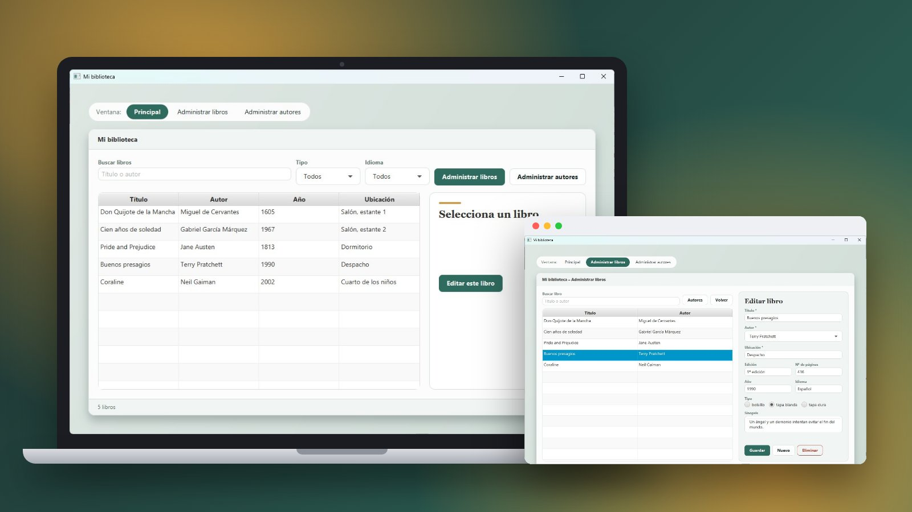
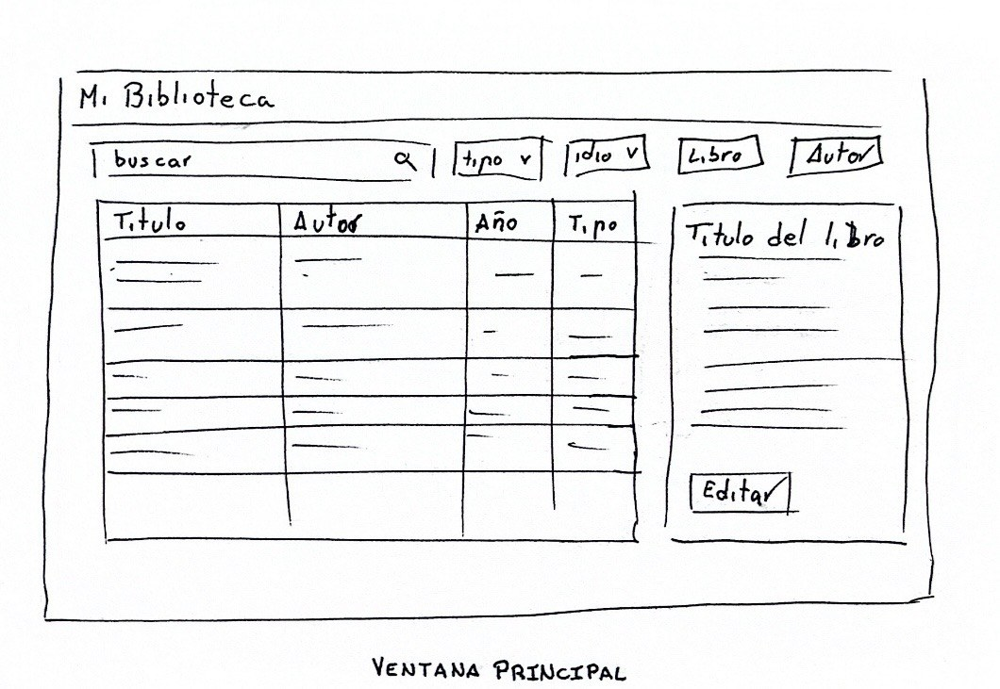
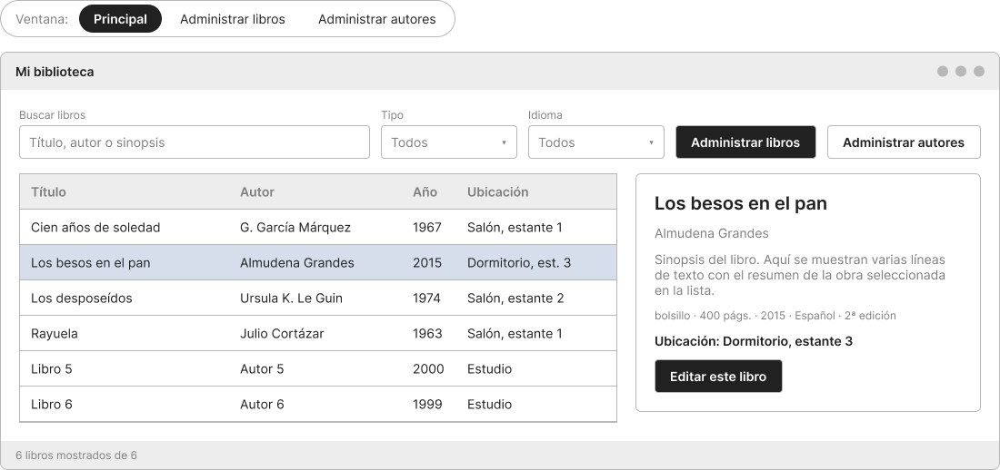
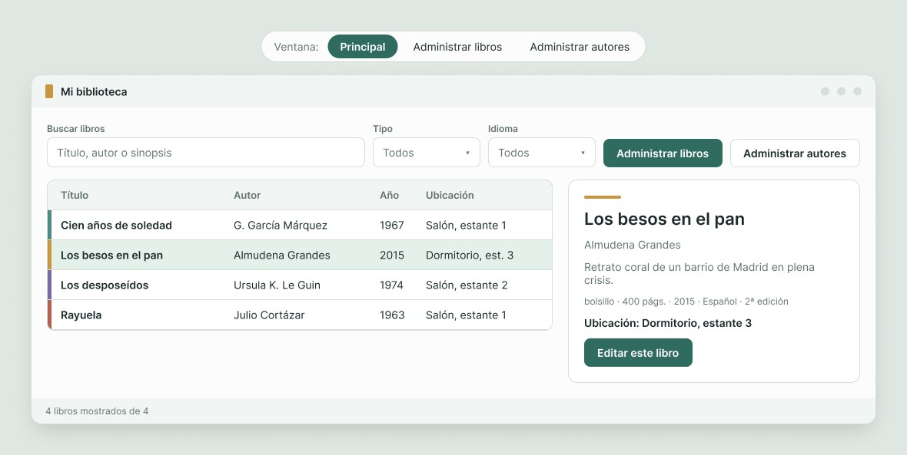
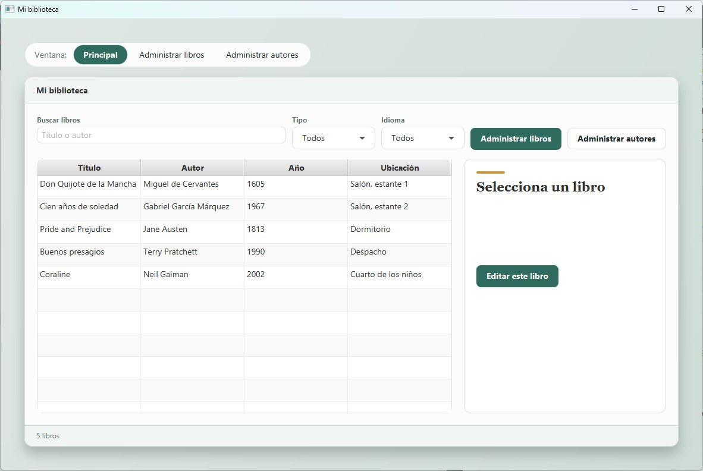
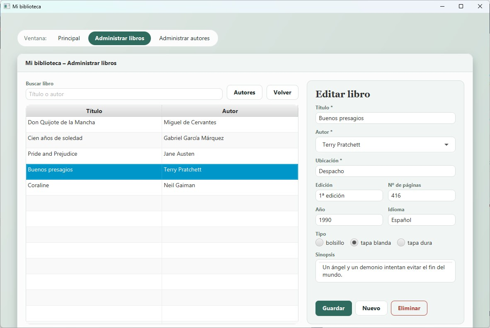
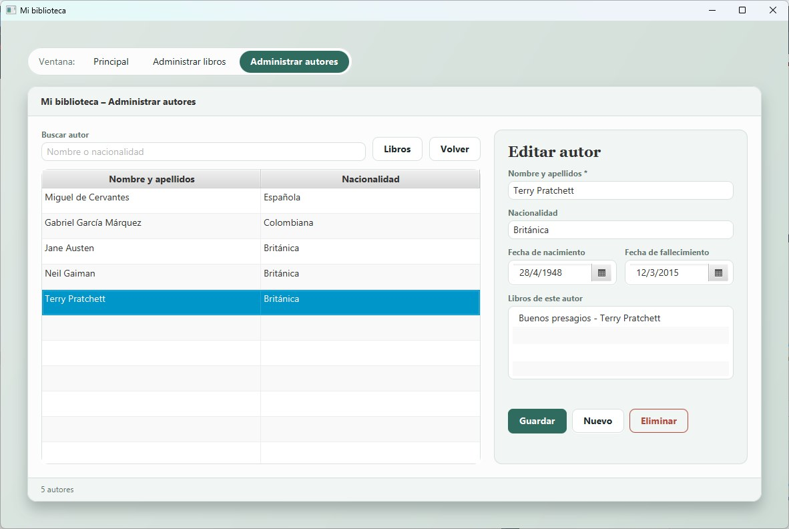
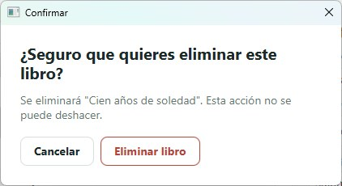

<div align="center">
  
</div>

<div align="center">
  <a href="https://github.com/evagr11/Biblioteca" target="_blank">
    
  </a>
  <a href="https://github.com/evagr11/Biblioteca/releases/latest" target="_blank">
    
  </a>
  <a href="https://evagr11.github.io/Biblioteca/" target="_blank">
    
  </a>
  <a href="documentacion/Mi_biblioteca.pdf" target="_blank">
    
  </a>
  <a href="https://www.figma.com/proto/MBpHA9vkrAKfltr0WOi7qj/Mi-biblioteca-%E2%80%93-Prototipo-navegable?node-id=1-292&starting-point-node-id=1%3A292" target="_blank">
    
  </a>
</div>

<br>

<div align="center">
  <a href="https://git.io/typing-svg"></a>
</div>

<div align="center">
  
</div>

---

# 🚀 Sobre el Proyecto

**Mi biblioteca** es una aplicación de escritorio en **JavaFX** para saber qué libros hay en casa y dónde están. Permite añadir, modificar, eliminar y buscar **libros** y **autores**, y consultar la ficha de cada libro.

La hice siguiendo todo el proceso de diseño de una interfaz: **sketch** a mano, **wireframe** y **prototipo navegable** en Figma, vistas con **SceneBuilder** y, al final, modelo y controladores con el patrón **MVC**.

✨ **Características principales:**

- 🔎 **Ventana principal** con buscador por título o autor, filtros de tipo e idioma y la ficha del libro seleccionado.
- 📚 **Administración de libros**: título, autor, ubicación, edición, páginas, año, idioma, tipo (bolsillo, tapa blanda o tapa dura) y sinopsis.
- ✍️ **Administración de autores** con fechas de nacimiento y fallecimiento (`DatePicker`) y la lista de sus libros.
- 🗑️ **Confirmación antes de eliminar** en una ventana modal, para libros y para autores.
- ⚠️ **Validaciones**: campos obligatorios con asterisco y errores en rojo que explican qué corregir; si las páginas o el año no son números, no se cierra la app.
- 🔗 **Relación muchos a muchos** entre libros y autores: al eliminar un autor, desaparece también de sus libros.
- 🎨 **Estilo propio**: verde sereno, detalles dorados y la misma estructura en las tres ventanas.
- 📖 **Javadoc** en todas las clases y métodos, publicado en [GitHub Pages](https://evagr11.github.io/Biblioteca/).

---

# 🧠 Contexto del Proyecto

Es una práctica de la asignatura **Desarrollo de Interfaces** de 2º de **DAM**, hecha en cuatro partes:

<div align="center">

| Parte | Qué se hizo |
| :---- | :---------- |
| **1** | Diseño de la interfaz: sketch, wireframe y prototipo de las tres ventanas |
| **2** | Vistas con SceneBuilder, sin lógica |
| **3** | Clases del modelo, que guardan los libros y los autores |
| **4** | Controladores que unen el modelo con la vista y completan el MVC |

</div>

Toda la práctica está explicada en la [documentación en PDF](documentacion/Mi_biblioteca.pdf) (LaTeX, 42 páginas): requisitos, diseño, estilo visual, implementación, pruebas y código.

---

# 🎨 Del boceto a la aplicación

<table align="center">
  <tr>
    <td align="center" width="33%"><br><em>1. Sketch a mano</em></td>
    <td align="center" width="33%"><br><em>2. <a href="https://www.figma.com/design/OKJrJVBE6Cq7DnDBW9bMlK/Mi-biblioteca-%E2%80%93-Wireframes">Wireframe en Figma</a></em></td>
    <td align="center" width="33%"><br><em>3. <a href="https://www.figma.com/proto/MBpHA9vkrAKfltr0WOi7qj/Mi-biblioteca-%E2%80%93-Prototipo-navegable?node-id=1-292&starting-point-node-id=1%3A292">Prototipo navegable</a></em></td>
  </tr>
</table>

| Ventana principal | Administración de libros |
| :---------------: | :----------------------: |
|  |  |
| *Buscador, filtros y ficha del libro.* | *Formulario para añadir, editar y eliminar.* |
| **Administración de autores** | **Confirmación al eliminar** |
|  |  |
| *Fechas con selector y libros del autor.* | *Ventana modal antes de borrar.* |

<div align="center">

| Color | Uso |
| :---: | :-- |
|  | Botones principales y ventana activa |
|  | Solo adorno, nunca en texto |
|  | Texto principal |
|  | Errores y eliminar |

</div>

---

# 🛠️ Stack Tecnológico

<p align="center">
  
  
  
  
  
  
</p>

<div align="center">

| Componente | Tecnología |
| :--------- | :--------- |
| **Lenguaje** | `Java 11` |
| **Interfaz** | `JavaFX 13` (`javafx-controls`, `javafx-fxml`) |
| **Vistas** | `FXML` hechos con `SceneBuilder`, estilos `-fx-*` en línea |
| **Build** | `Maven` + `javafx-maven-plugin` (arquetipo `javafx-archetype-fxml`) |
| **Diseño** | `Figma` (wireframes y prototipo navegable) |
| **Documentación** | `Javadoc` + memoria en `LaTeX` |

</div>

---

# 📂 Estructura del Proyecto

```bash
Biblioteca/
│
├── pom.xml
├── docs/                                  # Javadoc generado (publicado en GitHub Pages)
├── documentacion/
│   └── Mi_biblioteca.pdf                  # Memoria de la práctica
│
└── src/main/
    ├── java/
    │   ├── module-info.java               # Abre el modelo a las tablas de JavaFX
    │   └── org/example/
    │       ├── App.java                   # Arranque, cambio de ventana y confirmación
    │       ├── PrincipalController.java   # Busca, filtra y muestra la ficha
    │       ├── LibrosAdminController.java # Añade, modifica y elimina libros
    │       ├── AutoresAdminController.java# Añade, modifica y elimina autores
    │       ├── ConfirmarController.java   # Respuesta del diálogo de eliminar
    │       └── model/
    │           ├── Libro.java
    │           ├── Autor.java
    │           ├── TipoLibro.java         # Bolsillo, tapa blanda, tapa dura
    │           └── Biblioteca.java        # Guarda libros y autores y los busca
    └── resources/org/example/
        ├── PrincipalView.fxml
        ├── LibrosAdminView.fxml
        ├── AutoresAdminView.fxml
        └── ConfirmarView.fxml
```

---

# 🚀 Cómo Utilizar el Proyecto

### 💻 Descargar para Windows

No hace falta tener Java instalado: la descarga lleva su propia versión.

1. Descarga `MiBiblioteca-windows.zip` de la [última versión](https://github.com/evagr11/Biblioteca/releases/latest) y descomprímelo.
2. Abre la carpeta `bin` y haz doble clic en `MiBiblioteca.bat` (si el Explorador oculta las extensiones, aparece como `MiBiblioteca`).

### 📋 Requisitos para compilarla

- **JDK 11** o superior
- **Maven** (o el que trae IntelliJ IDEA)

### ▶️ Ejecutar la aplicación

```bash
git clone https://github.com/evagr11/Biblioteca.git
cd Biblioteca
mvn clean javafx:run
```

En **IntelliJ IDEA** también se puede lanzar desde el panel de Maven: `Plugins → javafx → javafx:run`. Arranca con cinco libros y cinco autores de ejemplo.

### 📦 Generar el zip para Windows

```bash
mvn clean javafx:jlink
```

Crea `target/MiBiblioteca-windows.zip`, con la aplicación y un Java reducido para ejecutarla. Se genera para el sistema donde se compila: hecho en Windows, funciona en Windows.

### 📖 Ver la documentación

- **Javadoc** online en **[evagr11.github.io/Biblioteca](https://evagr11.github.io/Biblioteca/)**, o abriendo `docs/index.html` en el navegador.
- **Memoria de la práctica** en [`documentacion/Mi_biblioteca.pdf`](documentacion/Mi_biblioteca.pdf).

---

# 🎯 Mejoras futuras

- 💾 **Guardar los datos** en un archivo o en una base de datos; ahora están en memoria y se pierden al cerrar.
- 👥 **Varios autores por libro** desde el formulario: el modelo ya los admite, pero el desplegable solo deja elegir uno.
- 🌍 **Idiomas del filtro** sacados de los libros, en vez de «Español» e «Inglés» fijos.
- 🎨 **Estilos en una hoja CSS**, que también cambie el azul por defecto de la fila seleccionada al verde de la app.
- 📐 **Ventana adaptable**: ahora está pensada para 1180 píxeles de ancho.
- 📦 **Instalador `.exe`** con icono y acceso en el menú Inicio, con `jpackage`, en vez de abrirla con un `.bat`.

---

<div align="center">
  <p>Creado por <strong>Eva Gallardo</strong></p>
  <a href="https://github.com/evagr11" target="_blank">
    
  </a>
  <a href="https://www.linkedin.com/in/eva-gallardo-romero-830362349/" target="_blank">
    
  </a>
</div>

<div align="center">
  
</div>
